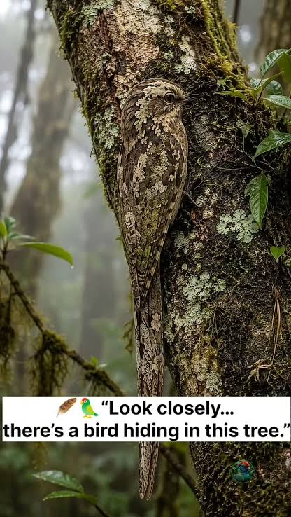

# JULIETT Demo Runbook: Birdwatching Simulator
 

**Live app:** https://ethan.barrycumbie.com/  
**Repo:** https://github.com/edmullins/Birdwatching-Simulator

---
 
## One-line pitch
 
A browser birdwatching game where you scan a real photo for tiny, camouflaged birds, hold space to raise your binoculars, and race a 5-minute clock that gets harder every level.

---
 
### 1. Problem + user
 
A lot of people can't tell common local birds apart, and the tools that exist for learning are either reference-style (guides, ID apps) or social/logging tools. They assume you are already outdoors and motivated. There's a gap for an in-browser, low-stakes practice game that builds the visual search and recognition skill (finding a small, partly hidden bird, then knowing what it is) that real birding depends on.


 
### 2. Experience the product: audience participation
 
**Steps:**
1. Navigate to https://ethan.barrycumbie.com/ or find the link through my github: **edmullins**
2. Create an account / Enter a username and password (must be 8 characters long)
3. hold space to zoom, binocular mask follows the cursor. Type birds name to capture it.
4. Round ends. Inspect the live leaderboard
 
### 3. Show something interesting
 
- **Difficulty ramp:** level 1 vs level 20 side by side. Birds shrink, hide behind occlusion layers, and start fleeing.
- **Flee behavior:** follow a bird that takes off and reappears elsewhere.
- **Pet system** feed and play with a bird you choose.

### 4. Behind the curtain
 
Keep this to **two** things.
 
1. **Layered rendering:** background → occlusion → birds 
```
function spawnOne() {
    if (!running) return;

    const def = pickWeightedBird(birdPool, rarityWeights, random);
    const depth = randomDepth();
    const scale = rand(distanceRange.min, distanceRange.max);

    const el = document.createElement('div');
    el.className = 'bird-sprite';
    el.dataset.rarity = def.rarity;
    el.style.setProperty('--bird-scale', scale);
    placeRandomly(el);

    const img = document.createElement('img');
    img.className = 'bird-image';
    img.src = def.imageUrl;
    img.draggable = false;
    img.alt = def.name ?? 'bird';
    el.appendChild(img);

    scene.getBirdLayer(depth).appendChild(el);
```
2. **Server-side run validation:** Invalid runs that are submitted get `status: "flagged"`. 
```
export async function validateRun({
  run,
  userId,
  outcome,
  birdsFound,
  endedAt = new Date(),
  previousMaxLevel = 0
}) {
  const violations = [];
  const submittedBirds = Array.isArray(birdsFound) ? birdsFound : [];

  if (!Array.isArray(birdsFound)) {
    violations.push('birdsFound must be an array');
  }

  const config = getLevelConfig(run.levelReached);
  const requiredBirds = config.minBirdsRequired;
  const elapsedMs = endedAt.getTime() - run.startedAt.getTime();
  const foundCount = submittedBirds.length;

  if (elapsedMs < 0) {
    violations.push('Run ended before it started');
  }

  if (run.levelReached > previousMaxLevel + 1) {
    violations.push('Levels must be completed sequentially');
  }

  ...

  return {
    valid: violations.length === 0,
    violations,
    elapsedMs,
    foundCount
  };
}
```
 
### 5. Reality check
 
Suggested content:

| Feedback | Tag | Suggestions | Effort |
|----------|-----|-------------|--------|
| **Auto-fill bird names** | 💡 consider | Add autocomplete on the `name` / `speciesName` fields to allow players to shortcut captures | Small |
| **Better occlusion layers** | 🔧 improve | Use transparent PNGs with feathered edges so branches and leaves blend into the background. | Medium |
| **Hold-to-zoom on mobile** | 🐛 fix | Add a hold-to-zoom button and make the binocular mask follow touch. | Small |
| **Level 1 onboarding** | 💡 consider | Add a short tutorial level or a hint overlay ("Hold space to zoom"). | Small |
| **Difficulty curve data** | 💡 consider | Record per-level clear rate and time-to-first-bird in `runs`. Use it to retune `minBirdsRequired` and density from real playtests. | Medium |
- **Issues:** https://github.com/edmullins/Birdwatching-Simulator/issues
---
## Thanks for playing.